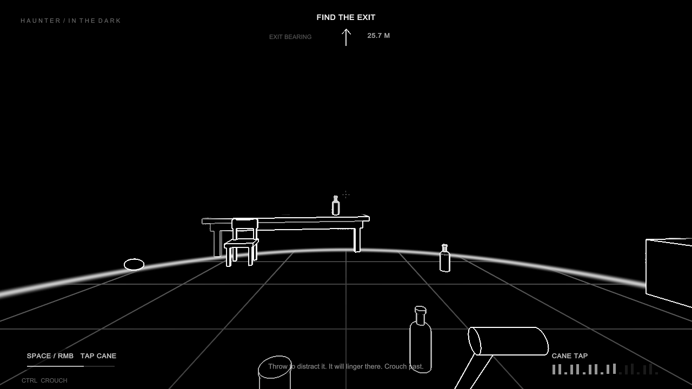

# Haunter in the Dark

A playable first-person Unity horror concept. Sound is your only sight: footsteps, cane taps, thrown objects and the creature's paws send expanding waves across a black world, briefly revealing white outlines.

**[Download and play for Windows (ZIP)](https://github.com/GraysonWills/haunter-in-the-dark/releases/latest/download/HaunterInTheDark-Windows.zip)** · [Release notes and source downloads](https://github.com/GraysonWills/haunter-in-the-dark/releases/latest)



## Play without Unity

1. Download **HaunterInTheDark-Windows.zip** using the link above.
2. Right-click the ZIP and choose **Extract All**.
3. Open the extracted folder and run **HaunterInTheDark.exe**. Keep it beside its `HaunterInTheDark_Data` folder, `UnityPlayer.dll`, and the other included files.
4. Press **Enter** to begin. Headphones help locate sounds.

This is a **Windows 64-bit desktop build**; Unity is not needed to play. Browser, macOS and Linux builds are not included. GitHub's **Code → Download ZIP** contains the Unity source project, not the playable Windows build.

## Controls and objective

| Control | Action |
|---|---|
| WASD / mouse | Move / look |
| Space or right mouse | Tap your cane |
| Ctrl or C | Crouch and move quietly |
| Shift | Run, making louder footsteps |
| E | Pick up the object under the crosshair / use the exit |
| Hold and release left mouse | Charge and throw the held object |
| Q | Drop the held object |
| Esc | Pause / resume and release the cursor |
| R after an ending | Restart |
| Alt+F4 | Close the game |

The arrow at the top points toward the exit. The creature guards that door and runs faster than your sprint. Crouching reduces how far it hears your steps. A nearby thrown-object impact can interrupt its pursuit of you. Once distracted, it commits to that impact area, reaches it, and investigates for **five full seconds** before returning to the exit. Footsteps, cane taps, other objects and repeated bounces cannot redirect it or restart that timer during the approach or linger. Its own paw sounds reveal the room without attracting it to itself. There are 32 cans, bottles and stones; held props keep their outlines visible.

Version 0.3 reduces hearing and makes distractions reliable: approximately **18 m walking**, **28 m sprinting**, **5 m crouching**, **12.6 m for a cane tap**, and **up to 8 m for object impacts**. Creature chase speed remains **5.8 m/s**, return speed **4.8 m/s**, player sprint **4.4 m/s**. It pursues heard positions rather than secretly tracking a silent player. A distraction's five-second timer starts on arrival at a reachable point beside the impact, including an impact on furniture; it is not consumed while walking there. After that interval it resumes guarding and can hear new sounds again. Walking directly into the creature is still dangerous while it is distracted.

## Unity project

1. Clone this repository, or download and extract **HaunterInTheDark-UnityProject.zip** from the [release page](https://github.com/GraysonWills/haunter-in-the-dark/releases/latest).
2. Install **Unity 2023.1.14f1** through Unity Hub, with **Windows Build Support** available if you want to make a Windows player.
3. In Unity Hub, choose **Add → Add project from disk** and select the folder containing `Assets`, `Packages`, and `ProjectSettings`.
4. Open the project with Unity 2023.1.14f1 and let the first import finish. Open `Assets/Haunter/Scenes/HaunterInTheDark.unity`, then press **Play**.

The project uses the **built-in render pipeline**. No Asset Store downloads, paid assets, imported audio, input-system package, or third-party dependencies are needed. Unity 2023.1.14f1 is the version used for the release; other editor versions have not been verified.

The saved scene is editable: move furniture, place props, adjust the creature and inspect the components. `Haunter → Rebuild prototype scene` regenerates the original authored room and replaces scene edits. `Haunter → Build Windows prototype` creates the Windows player.

### How the sight effect works

1. `NoiseSystem.Emit` publishes a hearing event and starts a spatial sound and a world-space wave.
2. `EchoSurface.shader` computes the wave arrival time at each surface fragment. Its temporary render target stores reveal masks, persistent-object masks and floor rings.
3. `OutlineComposite.shader` detects depth and normal discontinuities, then gates those white edges with the reveal mask. Faces stay black. Several waves can overlap; there is a short fading trail behind each wave.
4. Held objects and the cane use `_AlwaysVisible` so their outlines remain readable between echoes. Other surfaces return to black.

The synthetic audio, procedural room and creature are original placeholders. This is a fictional horror mechanic, not a simulation of blindness. The reference informs the visual language; no Avatar assets are used.

### Tuning

- **Game services → NoiseSystem:** `WaveSpeed` and `Afterglow` change propagation and fade. Up to 32 active waves; oldest waves are replaced when full.
- **Player → PlayerController:** movement speeds, mouse sensitivity, pickup reach, cane cooldown.
- **First person camera → EchoRenderer:** line width and brightness.
- **The listener → ListenerCreature:** chase/return speeds, paw interval, source-specific hearing, object listening time and guard offset. Footstep range is `clamp(loudness² × 80, 2, 28)` metres; cane range is `min(loudness × 14, 16)`; impact range is `min(loudness × 6, 8)`. Player steps grant 18–28 pawsteps and cane taps 12–20. Object investigations follow the full reachable path, then linger for `objectListenSeconds` (5 by default). The guard anchor is 2.2 m in front of the exit.
- **PrototypeWorld.cs:** room layout and prop positions. Navigation is rebuilt at runtime around static colliders; loose props are physical but do not carve the navigation mesh.

This is a single-level prototype with primitive art and procedural sound. The screen-space outline effect obeys camera occlusion: it does not reveal objects through solid walls. Large furniture is handled by navigation; small loose objects may be pushed by the creature.

`Haunter → Apply distraction balance and build` applies the version 0.3 creature tuning/spawn to the saved scene without rebuilding the room. Ordinary builds preserve Inspector tuning.

## Build and verify

In the editor, choose **Haunter → Build Windows prototype**. The output is `Builds/Windows/HaunterInTheDark.exe`; double-click it or use `Play.cmd` after the build completes. To share your build, zip the **entire** `Builds/Windows` folder so the EXE stays with its data and Unity DLLs.

Alternatively, close the project in Unity and run this from the project folder in PowerShell:

```powershell
powershell -NoProfile -ExecutionPolicy Bypass -File .\Build.ps1
```

The script finds Unity 2023.1.14f1 in the standard Unity Hub location or the standalone installation location. For a different location, specify the editor executable:

```powershell
powershell -NoProfile -ExecutionPolicy Bypass -File .\Build.ps1 -UnityPath "D:\Unity\2023.1.14f1\Editor\Unity.exe"
```

`-ExecutionPolicy Bypass` applies only to that PowerShell process; it does not change your saved execution policy. Build output is logged to `Logs/build.log`.

Run `Test.ps1` to execute the opt-in smoke test in a visible Windows player window (a hidden player returns black screen captures). It writes `Builds/Windows/Evidence/smoke-report.json` and eight screenshots, including darkness, the cane wave, held prop near a wall, creature, and both ending screens. It checks rendering, physics impacts, sound-driven AI, reachability and state transitions. Automated input is isolated from the keyboard. It has a real-time timeout and exits with a nonzero code on failure. The normal game does not run these checks.

Version 0.3.0 passed **50 checks with no failures or runtime errors**. See [verification details](docs/VERIFICATION.md) and the [recorded report](docs/evidence/smoke-report.json).

Rendering references: [Unity camera depth textures](https://docs.unity3d.com/2023.1/Documentation/Manual/SL-CameraDepthTexture.html) and [OnRenderImage](https://docs.unity3d.com/2023.1/Documentation/ScriptReference/MonoBehaviour.OnRenderImage.html).
